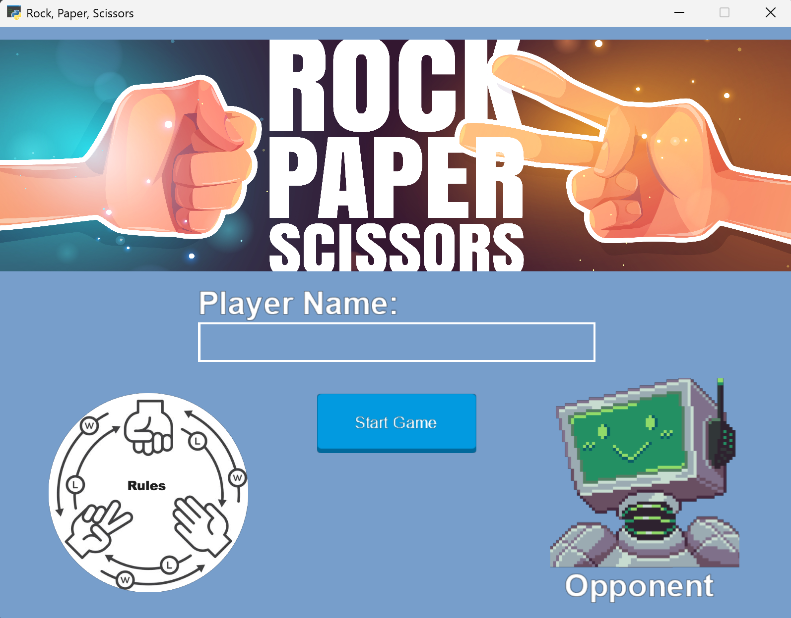
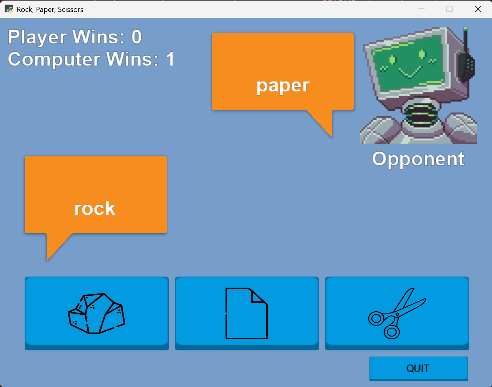

# Rock, Paper, Scissors

A desktop Rock, Paper, Scissors game built with Python and the [Arcade](https://api.arcade.academy/) library. You play against a computer opponent that adapts to you: it tracks which hands you throw and gradually shifts its own picks to counter your habits.



## Table of Contents

- [Objectives](#objectives)
- [Rules](#rules)
- [Installation](#installation)
- [Usage](#usage)
- [Features](#features)
- [How It Works](#how-it-works)
- [Project Structure](#project-structure)
- [Building the Executable](#building-the-executable)
- [Known Limitations](#known-limitations)
- [Future Ideas](#future-ideas)
- [Acknowledgments](#acknowledgments)

## Objectives

This is a personal Python project developed to learn how to build an event-driven game with multiple screens, GUI widgets, sprites, and sound, and to give the computer opponent a simple strategy instead of picking purely at random.

## Rules

Each round, you and the computer each choose one hand:

| Hand | Beats | Loses to |
|---|---|---|
| Rock | Scissors | Paper |
| Paper | Rock | Scissors |
| Scissors | Paper | Rock |

Matching hands are a tie, and neither side scores. There is no round limit: play as long as you like and watch the scoreboard.

## Installation

### Requirements

- **Python 3.10 or newer.** It was developed on Python 3.13.
- **Arcade 3.x.** The game uses Arcade 3's GUI and sprite-drawing API, so it won't run on Arcade 2.x.

It was developed and tested on Windows.

### Steps

```bash
git clone https://github.com/sathiarith/rock-paper-scissors.git
cd rock-paper-scissors

python -m venv .venv
# Windows:      .venv\Scripts\activate
# macOS/Linux:  source .venv/bin/activate

pip install -r requirements.txt
```

### Run

```bash
python main.py
```

**Windows only:** you can also skip installation and run the prebuilt `main.exe` in the `dist` folder.

## Usage

1. **Start screen.** Type your name in the *Player Name* box (optional; it defaults to "Player") and click **Start Game**. The rules are shown in the bottom-left corner.
2. **Play screen.** Click the **rock**, **paper**, or **scissors** button. Speech bubbles show your choice and the computer's choice, and the scoreboard in the top-left updates.
3. Keep playing as many rounds as you like. Click **QUIT** to close the game.

## Features

- **Adaptive computer opponent.** The computer plays randomly in the first round, then learns from your picks (see [How It Works](#how-it-works)).
- **Two screens.** A start screen with name entry and the rules, and a play screen with the scoreboard and hand buttons.
- **Personalized scoreboard.** Your typed name appears on the scoreboard next to your win count.
- **Visual feedback.** Image buttons with hover states, and speech bubbles that reveal each side's choice.
- **Sound.** Looping background music on the start screen and a sound effect on every button click.
- **Standalone executable.** A Windows `.exe` built with PyInstaller, so the game can be played without installing Python.

## How It Works

**Computer strategy.** The `Computer` class keeps a running count of how many times you've chosen rock, paper, and scissors. In the first round it picks at random. After that it turns your counts into frequencies and uses them as weights for a weighted random choice, shifted so each weight goes to the hand that **beats** that pick:

| If you tend to pick... | The computer leans toward... |
|---|---|
| Rock | Paper |
| Paper | Scissors |
| Scissors | Rock |

Because the choice is still random (just weighted), the computer can't be predicted exactly, but a player who keeps repeating the same hand will start losing more often.

**Deciding a winner.** A small lookup table maps each hand to the hand it beats and the hand it loses to, so `decide_winner()` takes a single dictionary lookup instead of a chain of `if` statements.

**Screens.** The game window (`Game`) switches between two Arcade `View`s, `Start` and `Play`. Each view has its own `UIManager`, which is enabled when the view is shown and disabled when it's hidden, so only the active screen responds to clicks. Widgets are positioned with anchor and box layouts, and button clicks are handled with Arcade's event decorators.

**Packaging.** A `resource_path()` helper resolves image and sound paths both when running from source and when running inside the PyInstaller executable, which unpacks its files to a temporary folder.

## Project Structure

```
rock-paper-scissors/
├── Graphics/          # button textures, hand images, title, rules, opponent, speech bubbles
├── Sounds/            # background music and button sound effect
├── dist/main.exe      # prebuilt Windows executable
├── main.py            # entry point: creates the window and starts the event loop
├── game.py            # Game window: size, title, and the first screen to show
├── screens.py         # Start and Play screens: layout, buttons, scoring, round logic
├── computer.py        # Computer opponent: tracks player picks and chooses a hand
└── main.spec          # PyInstaller build configuration
```

## Building the Executable

```bash
pip install pyinstaller
pyinstaller main.spec
```

The executable is written to `dist/`. The `Graphics` and `Sounds` folders must be bundled for the game to find its assets. `resource_path()` in `screens.py` handles the paths at runtime.

## Known Limitations

- The scoreboard resets every time the game is closed. Saving player history was planned and later removed.
- The computer only looks at your overall pick frequencies, not at patterns over time (for example, "after rock, this player usually picks paper").
- There is no tie counter, round counter, or match format (such as best-of-five).
- The window is a fixed 800x600 size.
- Tested on Windows only.

## Future Ideas

- Save player names and records between sessions.
- A smarter opponent that looks at your recent moves or common sequences, and a difficulty setting (random, adaptive, sequence-aware).
- Show ties and total rounds, and add a best-of-N match mode.
- A round-result message ("You win!", "Tie!") and short animations.
- Unit tests for `decide_winner()` and the computer's weighting.
- A mute button for the music.

## Acknowledgments

- [Arcade](https://api.arcade.academy/) for the game window, GUI widgets, sprites, and sound.
- [PyInstaller](https://pyinstaller.org/) for packaging the Windows executable.
- Graphics and sounds: *add the source and license for each asset here (for example, the background music track, button textures, and hand images).*